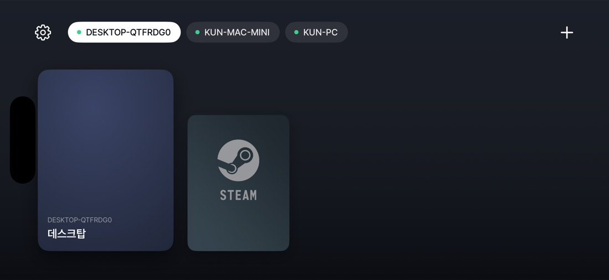

# KUNLIGHT (iPhone·iPad)

[Moonlight iOS](https://github.com/moonlight-stream/moonlight-ios)를 고쳐 쓰는 개인 빌드입니다. [Sunshine](https://github.com/LizardByte/Sunshine)이 켜진 PC의 화면을 아이폰·아이패드로 스트리밍합니다. 맥판은 [kunlight-mac](https://github.com/Kun-9/kunlight-mac)에 있습니다.

## 바뀐 점

- 콘솔식 홈: 위 줄에 PC 칩, 왼쪽부터 이어지는 표지 줄, 고른 게임의 흐린 배경.
- PC 칩과 게임은 꾹 눌러 끌면 순서가 바뀌고, 바꾼 순서는 저장됩니다.
- 실행 중인 게임은 표지에 초록 점, 누르면 바로 이어 하기.
- 흐린 표지를 깐 접속 중 화면.
- 통계를 카드나 한 줄 띠로 표시(설정 > 통계 모양).
- 설정 화면 어두운 테마, 알림 창까지 한국어, Pretendard 글꼴.
- 맥과 맞추기(선택): `tools/kunseed.py`가 맥 KUNLIGHT의 PC 목록·페어링·순서를 저장소 밖 파일로 뽑고, 빌드 때 앱에 넣습니다. 그 파일이 없으면 이 단계는 건너뜁니다. 개인 키가 들어가니 만든 앱은 남에게 주지 마세요.

## 빌드

`tools/local.env`에 내 값을 적고 `tools/build-iphone.sh`를 실행합니다. 이 파일은 저장소에 올라가지 않습니다.

    KUNLIGHT_TEAM=<Apple 팀 id>
    KUNLIGHT_BUNDLE_ID=<번들 id>
    KUNLIGHT_DEVICE=<기기 id>

무료 Apple 계정이면 7일마다 다시 설치해야 합니다. 원본 빌드 방법은 [README.moonlight.md](README.moonlight.md)에 있습니다.

## 라이선스

원본과 같은 GPLv3입니다. 글꼴 Pretendard 는 SIL Open Font License(`Limelight/Font/Pretendard/Pretendard-LICENSE.txt`)를 따릅니다.
